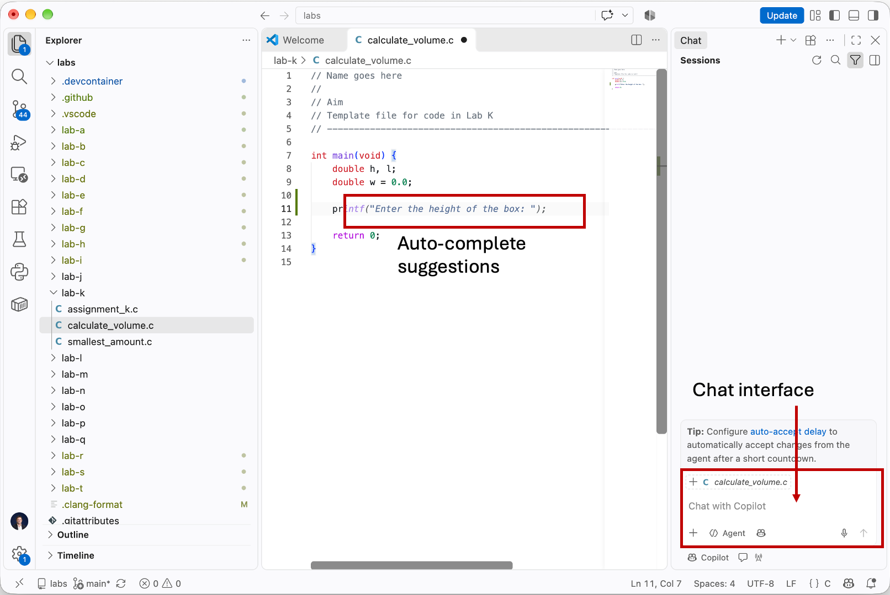

.. _ai_tools:

AI tools
========
Artificial Intelligence (AI) is having a rapid and profound impact on how we write and test code. Our aim in this course is for you to understand programming and writing code so that you have the fundamental knowledge in place, before then using AI to accelerate your work. Even if you use AI to accelerate your work, it is extremely important to have a solid understanding of what code is being produced and how it works. This is particularly true if you are working in regulated or safety critical environments. If you don't understand your own code, it's going to be very difficult for you to make it high performance, or to debug difficult cases. 

There are different ways in which AI is used in a programming interface:

- In-line auto-complete suggestions. As you type your code, you will see *auto-complete* suggestions pop-up where the AI tries to complete the line (or block) of code for you. If you press tab, you can accept the suggestion rather than typing in all of the code yourself.
- Chat pane. There is a chat box in the programming interface which lets you enter prompts. These could be direct requests for code, such as "*write a function which displays the current time*". Or they could be requests for feedback, such as "*review this code and give suggestions for improving it*". Or anything else. To get the best performance, your prompts probably want to be longer and more articulate than these ones! The chat pane will then display responses to you, and can directly made edits to your code if you would like. 
- Agentic coding. Here an AI agent does all of the coding work, with minimal input from you. We'll discuss this in more detail :ref:`on a dedicated page <agentic>`.

In-line auto-complete suggestions and the chat pane are shown in the figure below.

  Screenshot of VSCode, software from `Microsoft <https://code.visualstudio.com/>`_. See `course copyright statement <https://uom-eee-eeen11202.github.io/notes-part1/chapters/copyright.html>`_.

There are also multiple different things that you might ask of your AI:

- Generating code from scratch, starting with a blank file.
- Adding specific functions to an existing file.
- Explaining code that is already in place to help you understand it.
- Prompting to help fix/debug code that isn't working.
- Generating testing code for existing code.
- Generate test inputs and outputs to check our code.
- Generating documentation for the code.
- Helping to *refactor* code. That is, to take code that already fundamentally works, and re-arrange it to make it clearer and more scalable.

We'll explore some of these in the labs. In any company, its likely that they'll have policies in place saying what is acceptable use of AI. 

.. admonition:: This course

   AI tools are allowed during the course, but won't be available during the final exam. You are advised to make suitable, but informed and responsible, use of such tools. You should also read the AI use policy on Canvas. Our VSCode setup has the AI settings kept at their default values. 