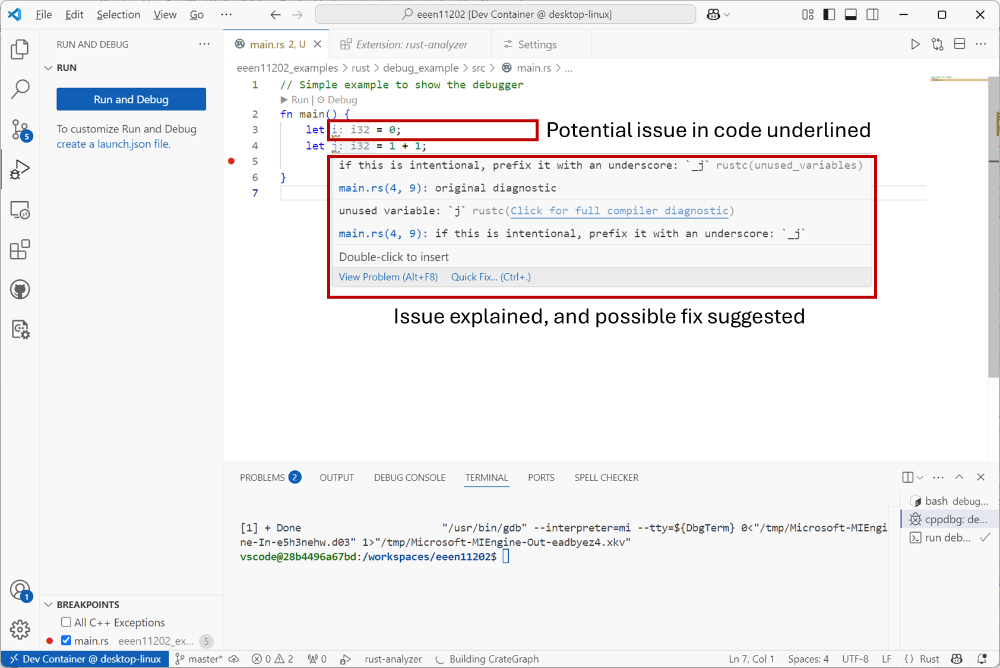

.. role:: rust(code)
   :language: rust

.. _static_code_analysis:

Static code analysis
====================

Static code analysis refers to checking your code for errors, before you run the code. This can avoid you wasting time trying to run code which has known issues or other reasons why it might not work. Remember, our simple examples will likely run or compile in a few seconds, but real programs with thousands or millions of lines of code might take hours or more to compile, and so failed runs can be a real time drain.

There are many different types of static code analysis. 

*Linting* is essentially a spell-check of your code. The example below shows Rust program code. The static code analysis has detected that the variable :rust:`j` (and indeed :rust:`i` in this simple example) is never used. The analysis is displaying a message checking that this is what you want, because it might indicate a mistake. Moreover, the analysis suggests using the preferred (but optional) style of using :rust:`_j` to indicate you're deliberately not using :rust:`j` for some reason. Indeed for a simple error like this offers a *Quick Fix* to automatically correct it for you. 

  Screenshot of VSCode, software from `Microsoft <https://code.visualstudio.com/>`_. See `course copyright statement <https://uom-eee-eeen11202.github.io/notes-part1/chapters/about/copyright>`_.

Linting is probably the most common form of static code analysis that you'll encounter. If desired, there are many other checks you can perform via static code analysis. For example, you can get analyzers that compare your code against a given style guide, or analyzers that examine the code for known security risks. We would encourage you to explore the VSCode interface, extensions, documentation, and online help to explore what other types of analysis might be useful.

.. admonition:: This course

   The pre-configured files you download for the labs set up the development tools to do linting automatically. We won't cover other forms of static code analysis. 